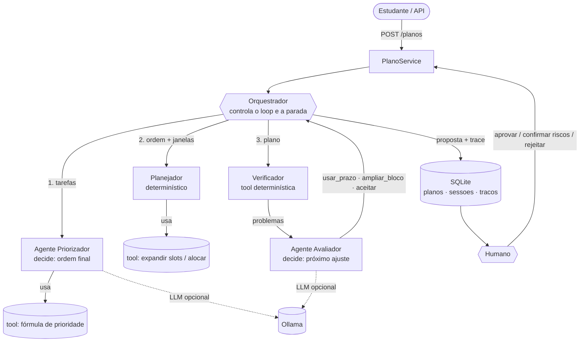

# agentics-system — Agente de Planejamento Acadêmico

Sistema multiagente que transforma tarefas, prazos e horários livres de um estudante em uma
**proposta de plano de estudos**, que só vale depois de aprovada por uma pessoa.

TADS · Técnicas Avançadas de Desenvolvimento de Software · UFMS

## 1. Problema

| | |
|---|---|
| **Usuário** | Estudante de graduação com várias disciplinas, prazos concorrentes e horários livres irregulares. |
| **Dor** | Decidir *o que estudar, quando e por quê* com tempo limitado; descobrir tarde que um prazo não cabe. |
| **Processo atual** | Lista/agenda manual ou priorização por "o que vence primeiro", sem checar se o conjunto cabe no tempo disponível. |
| **Valor gerado** | Plano concreto (sessões com data e hora), com justificativas, que **avisa antecipadamente** quais tarefas são inviáveis. |

## 2. Por que agentes (e onde *não* usar)

Um workflow fixo (ordenar por prazo → encaixar nos horários) falha em três pontos: a ordem ideal
depende de contexto que a fórmula não captura (ex.: várias tarefas difíceis seguidas); o primeiro
plano frequentemente viola prazos e precisa ser **revisado**; e é preciso decidir *qual ajuste
tentar* conforme o diagnóstico. Esses são os pontos de decisão delegados ao modelo.

O restante é **deliberadamente determinístico**: calcular pontuação, expandir a disponibilidade,
alocar horários e validar o plano são problemas com regras exatas, em que um erro do LLM geraria
um plano inválido. Com `LLM_HABILITADO=false` o sistema inteiro roda só com regras, e esse
também é o *fallback* automático quando o modelo falha.

## 3. Arquitetura



Fluxo ponta a ponta: **priorizar → planejar → verificar → avaliar → (revisar, até
`MAX_REVISOES`) → salvar proposta → aprovação humana**.

### Agentes e responsabilidades

| Componente | Recebe | O que decide | Ferramentas | Guardrails |
|---|---|---|---|---|
| **Priorizador** (`agents/prioritizer.py`) | tarefas pendentes + ranking da fórmula | a **ordem final** (pode divergir da fórmula) | `tools/priority.py` | resposta = permutação exata dos ids; ninguém se move mais de `MAX_DESLOCAMENTO_LLM` posições; **títulos nunca vão ao prompt**; erro → ranking da fórmula |
| **Planejador** (`agents/planner.py`) | ordem, janelas livres, parâmetros | nada (executa) | `tools/scheduling.py` | determinístico; nunca ultrapassa prazo, disponibilidade ou teto diário |
| **Verificador** (`tools/validation.py`) | plano + entradas | nada (mede) | — | revalida tudo de forma independente do planejador |
| **Avaliador** (`agents/evaluator.py`) | diagnóstico do verificador | **qual ajuste tentar** (conjunto fechado) | — | ação ∈ {ajustes ainda não tentados, `aceitar`}; sem problema corrigível não chama o LLM; erro → regra |
| **Orquestrador** (`orchestrator.py`) | tudo acima | **quando parar** (código, nunca o LLM) | — | limite de revisões; mantém o *melhor* plano visto |
| **Humano** | proposta de plano | aprovar / rejeitar / aceitar riscos | `/planos/{id}/aprovar` | planos com problemas exigem `confirmar_riscos=true` |

### Diagnóstico do Verificador

| Tipo | Significado | Corrigível por revisão? |
|---|---|---|
| `cobertura_incompleta` | faltou alocar, mas em tese cabe | sim (muda estratégia/bloco) |
| `inviavel` | não cabe nem sozinha até o prazo | não → sinalizada ao humano |
| `sobrecarga` | cabe sozinha, mas a carga acumulada até o prazo não cabe | não → sinalizada ao humano |
| `sobreposicao`, `fora_da_disponibilidade`, `apos_prazo`, `no_passado`, `horas_excedentes` | violações estruturais (bug do planejador) | sim |

Separar o que é corrigível evita gastar revisões em problemas que nenhum plano resolve.

### Limites de autonomia

- Agentes **só propõem**: nunca criam, alteram ou removem tarefas ou disponibilidade (coberto por teste).
- O LLM só escolhe entre opções fechadas (ordem dos ids existentes; ações de um enum).
- Toda resposta do LLM é validada; qualquer falha cai em regra determinística e é registrada no trace.
- Plano com riscos conhecidos não é aprovado sem confirmação explícita.

### Checklist arquitetural

- **Objetivo do agente**: Priorizador = ordem de estudo; Avaliador = próximo ajuste do plano.
- **Decisão delegada ao modelo**: ordem final e escolha de ação. Nada além.
- **Tools que pode / não pode usar**: só recebe dados numéricos; não escreve em banco, não lê títulos.
- **Estado entre passos**: `Parametros` + conjunto de ações já tentadas, mantidos pelo orquestrador.
- **Quem controla o loop**: o orquestrador (`MAX_REVISOES`, esgotamento de ajustes, aceite).
- **Aprovação humana**: aprovar/rejeitar plano; confirmar riscos.
- **Como testar**: `pytest` + `python -m evals.run` (seção 5).
- **Como observar/reproduzir falha**: trace persistido por plano + logs JSON (seção 6).

## 4. Como executar

```bash
python -m venv .venv && source .venv/bin/activate      # Windows: .venv\Scripts\activate
pip install -r requirements.txt
cp .env.example .env
python -m data.seed --reset        # dados fictícios (inclui uma tarefa propositalmente inviável)
uvicorn main:app --reload          # docs interativas em http://localhost:8000/docs
```

> Se você já tinha um `agenda.db` de versões anteriores, use `--reset`: o schema ganhou as
> tabelas `planos` e `tracos`, e `sessoes.versao` agora referencia `planos.id`.

Fluxo mínimo:

```bash
curl -X POST localhost:8000/planos                                   # gera a PROPOSTA
curl localhost:8000/planos/1/trace                                   # o que cada agente fez
curl -X POST localhost:8000/planos/1/aprovar                         # 422 se houver riscos
curl -X POST localhost:8000/planos/1/aprovar \
     -H 'content-type: application/json' -d '{"confirmar_riscos": true}'
```

### Habilitando o LLM (opcional)

```bash
ollama pull qwen2.5:3b
# no .env:  LLM_HABILITADO=true
```

| Endpoint | Função |
|---|---|
| `POST /planos` | executa os agentes e salva uma proposta |
| `GET /planos`, `GET /planos/{id}` | lista / detalha (ordem, problemas, revisões, sessões) |
| `GET /planos/{id}/trace` | eventos dos agentes, em ordem, com duração |
| `POST /planos/{id}/aprovar` · `/rejeitar` | decisão humana |
| `/disciplinas`, `/tarefas`, `/disponibilidade`, `/prioridades` | dados e ranking determinístico |

## 5. Qualidade: testes e evals

```bash
pytest -q                     # unitários, API, guardrails e integração dos evals
python -m evals.run --salvar  # cenários de avaliação -> evals/relatorio.md
```

Os evals (`evals/cenarios.py`) usam datas fixas e um **LLM roteirizado** (`evals/fakes.py`), então
são reproduzíveis e não dependem de rede. Cobrem: invariantes do plano (sem sobreposição, dentro
da disponibilidade e do prazo); revisão que realmente conserta um plano ruim; tarefas inviáveis e
sobrecarga sinalizadas sem gastar revisões; respeito ao limite de revisões; determinismo; e
robustez a respostas ruins do LLM (ordem inválida, deslocamento excessivo, ação fora do enum, LLM
fora do ar) e ausência de texto do usuário nos prompts.

## 6. Observabilidade e tratamento de falhas

- Cada geração cria um `Tracer`; os agentes emitem eventos (`ajuste_llm`, `fallback`, `decisao`,
  `plano_gerado`, `validar`, `fim`) sem receber o tracer por parâmetro (`ContextVar`).
- Os eventos são **persistidos na tabela `tracos`** junto do plano e expostos em
  `GET /planos/{id}/trace`; também saem como JSON no logger `agentes`.
- Falha do LLM (timeout, HTTP, JSON inválido, resposta fora do contrato) → fallback determinístico
  + evento `fallback` com o motivo. O plano continua sendo gerado.

## 7. Estrutura do Projeto

```text
controllers/       # Rotas e endpoints FastAPI
views/             # Schemas de validação Pydantic
services/          # Regras de negócio
models/            # Modelos SQLAlchemy
agents/             # Agentes: priorizador, planejador e avaliador
                    # Protocolos e contratos dos agentes
tools/              # Ferramentas: prioridade, agendamento e validação
repositories/       # Acesso e operações com dados
data/               # Dados iniciais (seed)
evals/              # Cenários e execução de avaliações
tests/              # Testes automatizados com pytest

orchestrator.py     # Orquestração dos agentes
llm.py              # Integração com modelos de linguagem
observability.py    # Monitoramento e rastreabilidade
plano_service.py    # Serviço de gerenciamento de planos

## 8. Limitações e próximos passos

- Os prompts foram validados com dublês, **não contra um modelo Ollama real**; vale medir a taxa
  de fallback com `qwen2.5:3b` e ajustar os prompts.
- O alocador é guloso; casos-limite poderiam usar otimização (ex.: programação inteira).
- Sem autenticação nem multiusuário (um único estudante).
- Replanejamento ao longo do tempo (sessões não cumpridas) e integração com calendário externo.
